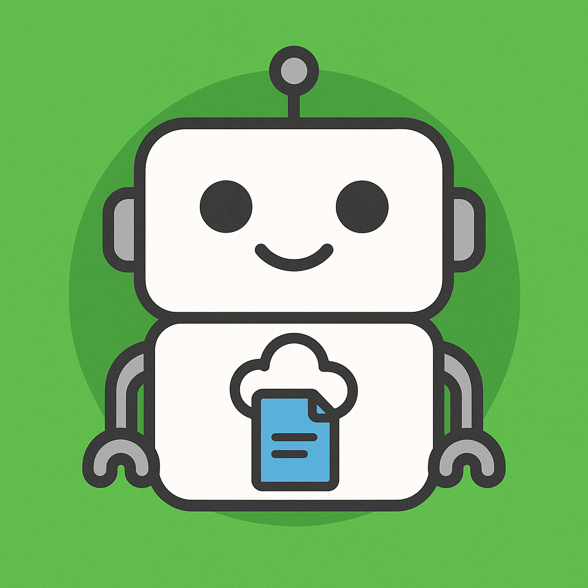
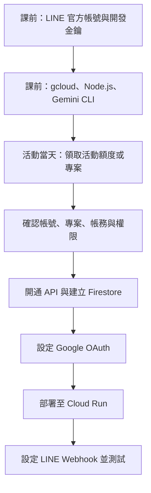
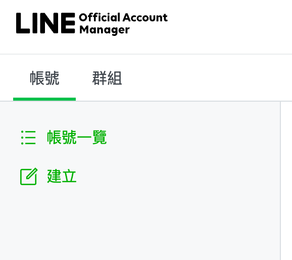
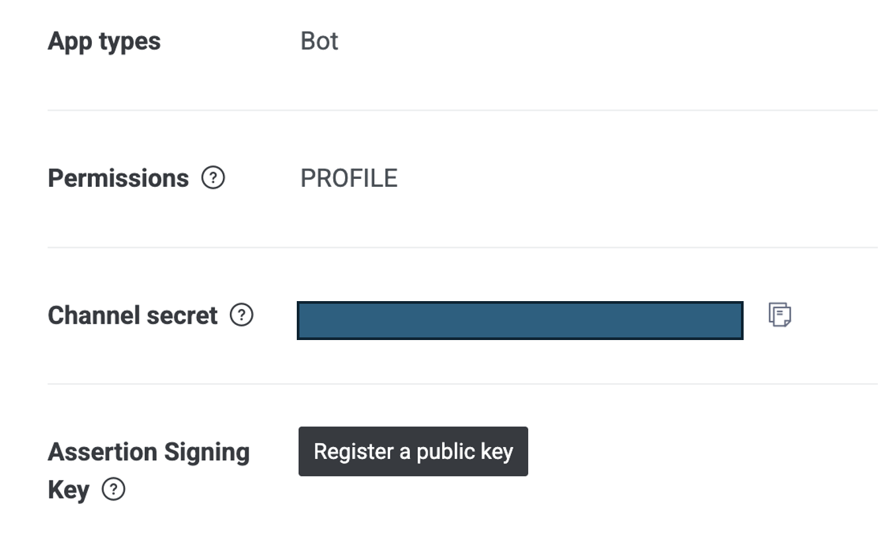
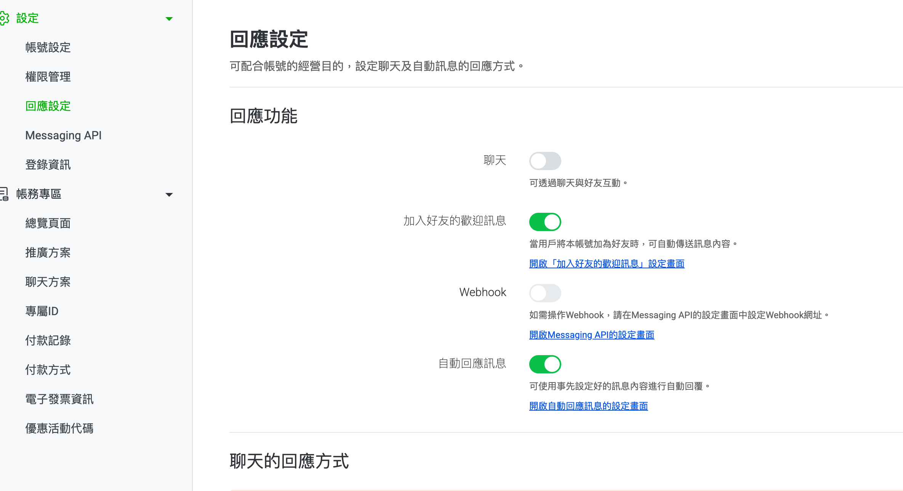

# 🤖 LINE Bot 實作課程：從零開始部署到 Google Cloud Run

從建立 LINE 官方帳號開始，完成 Google Cloud 設定、部署及 Google Drive 授權，做出能備份圖片與檔案的 LINE Bot。

本教材參考 [kkdai/BwAI-2026](https://github.com/kkdai/BwAI-2026) 與 [kkdai/bwai2026-sample](https://github.com/kkdai/bwai2026-sample)，補上活動額度領取、第一次使用 Google Cloud 的操作及部署檢查。範例程式使用 Go；Gemini CLI 用來協助理解程式與操作工具。AI 聊天功能可在完成本課程後另外擴充。



本教材沿用原教材的插圖與操作截圖，完整出處見[圖片來源](assets/screenshots/README.md)。圖中的專案名稱、電子郵件與介面狀態是原教材示例；操作時請依文字步驟，使用自己的帳號與活動專案。

> [!IMPORTANT]
> **活動當天的 Google Cloud 入口：[g.dev/credits/adxtw-bdc-linebot-nov26](https://g.dev/credits/adxtw-bdc-linebot-nov26)**
>
> 活動開放前，可以先完成 LINE 帳號與本機工具準備。活動額度、有效期限、帳號資格及專案提供方式，以活動開放後的領取頁面與現場說明為準。
>
> 若目前還沒有可用專案，先做到課前準備即可；Google Cloud 專案與帳務步驟於活動當天繼續。請使用同一個 Google 帳號完成領取、Console 登入及工具授權。

## 🗺️ 課程流程



| 階段 | 要完成的事 | 完成標準 |
| --- | --- | --- |
| 課前準備 | LINE 官方帳號、工具安裝 | 已取得 LINE 兩組金鑰，工具可顯示版本 |
| [Google Cloud 設定](docs/01-google-cloud.md) | 活動領取、專案、帳務、API、Firestore、服務帳戶 | 帳務可用，Firestore 與部署權限就緒 |
| [部署與測試](docs/02-deploy.md) | OAuth、Cloud Run、LINE Webhook | LINE Verify 成功，圖片可備份到 Drive |
| [問題排查](docs/03-troubleshooting.md) | 常見錯誤與排除方式 | 找到對應訊息與處理步驟 |

## ✅ 課前準備

- 一個可使用 LINE 的帳號。
- 一個活動允許使用的 Google 帳號。
- 可開啟終端機、安裝工具的電腦，或活動提供的開發環境。
- Git、Google Cloud CLI、Node.js 與 Gemini CLI。

若採用 Cloud Build 建置與 Cloud Run 部署，這次範例不需要在本機安裝 Go 或 Docker。

## 🔑 Workshop 1：建立 LINE 官方帳號

### 1. 建立帳號並啟用 Messaging API

1. 開啟 [LINE Official Account Manager](https://manager.line.biz/)，使用 LINE 帳號登入。
2. 依畫面建立官方帳號，填寫名稱、聯絡信箱及用途等資料。



3. 進入該帳號的「設定」→「Messaging API」，啟用 Messaging API。


4. 選擇或建立管理此服務的 Provider。公司專案請依公司安排選擇；個人練習可建立自己的 Provider。
5. 到 [LINE Developers Console](https://developers.line.biz/console/)，開啟對應 Provider 下的 Messaging API Channel。

Provider 綁定後無法任意更換。現在的建立順序是先有官方帳號，再啟用 Messaging API。

### 2. 取得兩組開發金鑰

| 金鑰 | 在 LINE Developers 的位置 | 本課程範例程式的環境變數 |
| --- | --- | --- |
| Channel secret | Basic settings → Channel secret | `ChannelSecret` |
| Channel access token | Messaging API → Channel access token (long-lived) → Issue | `ChannelAccessToken` |

先保管在自己的本機設定中，部署時再填入。環境變數大小寫依範例程式為準；本課程已核對[指定版本的程式](https://github.com/kkdai/bwai2026-sample/blob/10f0bb3d35452db35c192c0ba9e2c63e89777f30/main.go)。

**Channel secret：** 在 Basic settings 分頁向下找到此欄位。



**Channel access token：** 在 Messaging API 分頁找到 long-lived token 欄位，尚未發行時先按 Issue。


### 3. 設定官方帳號回應方式

在官方帳號後台的回應設定中，關閉「自動回應訊息」與「加入好友歡迎訊息」，讓程式統一回覆。選項名稱可能隨後台更新調整。



上圖示範設定位置。請將圖中的「加入好友的歡迎訊息」與「自動回應訊息」切換為關閉；完成部署後再開啟 Webhook。

Webhook URL 與「Use webhook」會在取得 Cloud Run 網址後設定。此範例先使用一對一聊天，關閉加入群組功能。

## 🛠️ Workshop 2：安裝開發工具

### 1. 安裝 Git 與 Google Cloud CLI

macOS 已有 Homebrew 時，可執行：

```bash
brew install git
brew update
brew install --cask gcloud-cli
```

Windows、Linux 或未安裝 Homebrew，請依 [Git 安裝說明](https://git-scm.com/downloads)及 [Google Cloud CLI 官方安裝說明](https://docs.cloud.google.com/sdk/docs/install-sdk)操作。

安裝後重新開啟終端機，確認：

```bash
git --version
gcloud --version
```

這個階段先確認工具安裝成功；活動開放後，再依 [Google Cloud 設定](docs/01-google-cloud.md)執行登入與專案選擇。

### 2. 安裝 Node.js 與 Gemini CLI

安裝 [Node.js](https://nodejs.org/en/download)；建議使用受維護的 Node.js 24，並符合 [Gemini CLI 的執行環境要求](https://geminicli.com/docs/get-started/installation/)。

```bash
node --version
npm --version
npm install -g @google/gemini-cli
gemini --version
```

啟動 Gemini CLI：

```bash
gemini
```

依帳號與活動提供的方式登入。Gemini CLI 登入和 gcloud 登入是不同步驟，使用其中一個工具登入，不代表另一個已完成授權。若活動指定專案或認證方式，依現場安排設定。

> 課前完成以上步驟後，等待活動額度開放。當天從 [Google Cloud 專案設定](docs/01-google-cloud.md)繼續。

## ☁️ Workshop 3：活動當天的 Google Cloud 操作

按順序完成：

1. 開啟[活動領取連結](https://g.dev/credits/adxtw-bdc-linebot-nov26)，以指定帳號領取。
2. 確認實際可用的 Project ID 與帳務狀態。
3. 執行 gcloud 初始化與必要的 ADC 授權。
4. 開通 Cloud Run、Cloud Build、Firestore、Artifact Registry、Drive 等 API。
5. 檢查或建立台灣區域的 Firestore，設定執行服務帳戶與建置權限。

完整指令及檢查方式：[Google Cloud 設定指南](docs/01-google-cloud.md)。

## 🚀 Workshop 4：部署 LINE Bot

接著完成：

1. 取得本課程核對過版本的範例程式。
2. 建立 Google OAuth 測試應用程式與網頁用戶端。
3. 設定環境變數，將金鑰設定檔排除於 Git 與建置內容之外。
4. 部署至 Cloud Run，取得服務網址。
5. 補上 Google OAuth 重新導向網址。
6. 設定 LINE Webhook，驗證及傳送圖片測試。

完整步驟：[部署與驗收指南](docs/02-deploy.md)。

## 🔌 選修：讓 Gemini CLI 使用 MCP

以下功能用於協助查閱文件或開發 Maps 功能，可在完成主要課程後再做。

### Google Developer Knowledge

1. 在活動專案的 API 程式庫確認可啟用 Developer Knowledge API。
2. 建立 API 金鑰，將 API 限制設為 Developer Knowledge API；若活動限制建立金鑰，依工作人員安排。
3. 將下列 `YOUR_API_KEY` 替換為自己的值，於本機執行：

```bash
gemini mcp add -t http \
  -H "X-Goog-Api-Key: YOUR_API_KEY" \
  google-developer-knowledge \
  https://developerknowledge.googleapis.com/mcp \
  --scope user
```

### Google Maps Platform Code Assist

```bash
gemini mcp add google-maps-platform-code-assist npx -y @googlemaps/code-assist-mcp@latest
```

這是開發輔助工具；實際呼叫 Maps 服務仍需另外確認相應 API、金鑰、帳務及活動額度的適用範圍。

在 Gemini CLI 執行 `/mcp list` 查看狀態，或請它查詢 Cloud Run 部署需求，確認有使用對應工具。

## 📚 參考資料

- [原始課程：kkdai/BwAI-2026](https://github.com/kkdai/BwAI-2026)
- [LINE Bot 檔案備份範例：kkdai/bwai2026-sample](https://github.com/kkdai/bwai2026-sample)
- [LINE Messaging API 入門](https://developers.line.biz/en/docs/messaging-api/getting-started/)
- [Cloud Run 從原始碼部署](https://docs.cloud.google.com/run/docs/deploying-source-code)
- [Google Cloud CLI 安裝](https://docs.cloud.google.com/sdk/docs/install-sdk)
- [Gemini CLI 文件](https://geminicli.com/docs/)

教材核對日期：2026-11-23。活動專案尚未開放，本教材的完整活動部署驗收留待開放後進行；額度與權限條件請以活動現場資訊為準。
