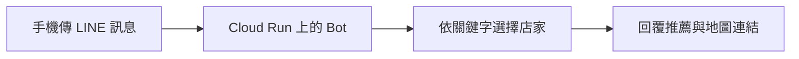
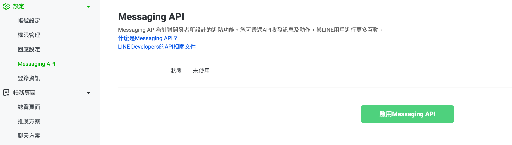
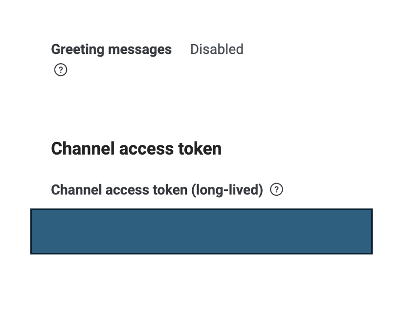

# 🍜 90 分鐘：做出自己的北科大美食 LINE Bot

**這堂課只做一件事：建立自己的 LINE Bot，部署後能回覆訊息。**

在 LINE 問「北科大附近有什麼好吃？」，你的 Bot 會回覆 3 家示範店家、推薦內容與 Google Maps 連結。再問「想吃麵」「便當」或「咖啡廳」，就能篩選類別。

這個 repo 已附上可直接部署的程式，使用預先整理的店家資料與關鍵字配對，不需要 AI 或地圖 API 金鑰。同學完成部署後，可以換成自己推薦的店家。


> [!IMPORTANT]
> **活動當天入口：[g.dev/credits/adxtw-bdc-linebot-nov26](https://g.dev/credits/adxtw-bdc-linebot-nov26)**
>
> 活動尚未開放時，先完成 LINE 帳號準備。領取額度、專案提供方式、有效期限及權限，以活動開放後的頁面與現場說明為準。

## 你需要準備

- 一台可使用瀏覽器的電腦，以及手機上的 LINE。
- 一個活動允許使用的 Google 帳號。
- 活動當天可使用的 Google Cloud 專案與帳務。

課程使用瀏覽器裡的 **Cloud Shell**。課堂操作都在瀏覽器完成，程式由 Cloud Build 建置；本機工具安裝可省略。

## 90 分鐘怎麼進行

| 時間 | 內容 |
| --- | --- |
| 0–10 分鐘 | 看完成範例，認識訊息如何到達 Bot |
| 10–30 分鐘 | 建立 LINE 官方帳號、取得金鑰 |
| 30–45 分鐘 | 領取活動專案、開啟 Cloud Shell |
| 45–65 分鐘 | 填入金鑰、部署 Bot |
| 65–75 分鐘 | 設定 Webhook，用手機測試 |
| 75–90 分鐘 | 排除問題、修改自己的店家推薦 |

建議課前先完成 LINE 帳號準備。活動專案與權限需由講師事先確認；此時間表預留 15 分鐘處理操作問題，仍須以當天環境彩排驗證。



## 1. 建立自己的 LINE 官方帳號

### 建立帳號並啟用 Messaging API

1. 開啟 [LINE Official Account Manager](https://manager.line.biz/)，用 LINE 帳號登入。
2. 建立官方帳號，填寫帳號名稱、聯絡信箱與用途等資料。


3. 在該帳號的「設定」→「Messaging API」，按「啟用 Messaging API」。



4. 選擇或建立自己的 Provider。這是管理 Bot 的服務提供者，綁定後無法任意更換。
5. 開啟 [LINE Developers Console](https://developers.line.biz/console/)，進入該 Provider 下的 Messaging API Channel。

### 取得兩個金鑰

| 要取得的值 | 位置 | 程式的環境變數 |
| --- | --- | --- |
| Channel secret | Basic settings → Channel secret | `LINE_CHANNEL_SECRET` |
| Channel access token | Messaging API → Channel access token (long-lived) → Issue | `LINE_CHANNEL_ACCESS_TOKEN` |

**Channel secret 的位置：**


**Channel access token 的位置：**



先保管好兩個值，下一節會填入自己的設定檔。金鑰只填在自己的環境，請勿貼到公開 repo 或分享畫面。

### 調整回應設定

回到官方帳號後台的「回應設定」，關閉「加入好友的歡迎訊息」與「自動回應訊息」。


上圖示範選項位置，請將歡迎訊息與自動回應切換為關閉。Webhook 會在部署成功後開啟，這堂課先使用一對一聊天。

## 2. 開啟活動專案與 Cloud Shell

1. 活動開放後，進入[指定領取連結](https://g.dev/credits/adxtw-bdc-linebot-nov26)，以活動允許的帳號完成領取。
2. 開啟 [Google Cloud Console](https://console.cloud.google.com/)，選擇活動實際使用的專案，記下 **Project ID**。
3. 點 Console 右上角的 **啟用 Cloud Shell** 終端機圖示，依提示開啟並授權。
   
   
   
   
   
   


4. cloud shell 輸入 "agy", 開啟 google Antigravity
5. 更改model, 選 Neon


6. 在 **Antigravity (agy) 對話框**輸入「請幫我跑這段」，並貼上以下指令：

```bash
git clone https://github.com/zonawang/line-bot-course.git
cd line-bot-course
```
7. 這時候你可能會出現這個畫面
   
點中間的網址，去啟用就可以開始使用


## 3. 填入金鑰並部署

在 Cloud Shell 終端機切換到專案資料夾、建立自己的設定檔並開啟編輯器。如果已在 `line-bot-course` 資料夾內，請略過第一行：

```bash
cd line-bot-course
cp local.env.example.yaml local.env.yaml
cloudshell edit local.env.yaml
```

把兩個佔位值換成剛才取得的金鑰，保留欄位名稱及引號，儲存檔案：

```yaml
LINE_CHANNEL_SECRET: "YOUR_LINE_CHANNEL_SECRET"
LINE_CHANNEL_ACCESS_TOKEN: "YOUR_LINE_CHANNEL_ACCESS_TOKEN"
```

設定檔已從 Git、來源上傳與 Docker 建置內容排除。課程程式只需要這兩個值。


填好金鑰並儲存後，在 **Antigravity (agy) 對話框**輸入以下內容，將 `YOUR_PROJECT_ID` 換成自己的實際 Project ID：

```text
我已填好並儲存 line-bot-course/local.env.yaml。請幫我將這個專案部署到 Google Cloud Run，Project ID 是 YOUR_PROJECT_ID，服務名稱是 linebot-course，區域是 asia-east1。若尚未完成雲端環境準備，請先執行 bash scripts/setup-cloud.sh，再使用 bash scripts/deploy.sh 部署，執行時請帶入對應參數。完成後請提供健康檢查網址與 LINE Webhook URL。
```

也可以直接在 Cloud Shell 終端機執行。請確認目前位於 `line-bot-course` 資料夾，並將下列兩行的 `YOUR_PROJECT_ID` 換成自己的實際 Project ID：

```bash
bash scripts/setup-cloud.sh "YOUR_PROJECT_ID"
bash scripts/deploy.sh "YOUR_PROJECT_ID" "linebot-course" "asia-east1"
```

若講師已完成雲端環境準備，可略過 `setup-cloud.sh`。共用專案的同學，請將服務名稱 `linebot-course` 改成自己的英文代號，例如 `linebot-alice`；若活動指定其他區域，請一併修改 `asia-east1`。

等待建置與部署完成。終端機會顯示：

```text
健康檢查：https://你的服務網址/health
LINE Webhook URL：https://你的服務網址/webhook
```

開啟健康檢查網址，看到 `"status":"ok"` 代表伺服器已啟動。


## 4. 接通 LINE 並測試

1. 回到 [LINE Developers Console](https://developers.line.biz/console/) → 你的 Channel → Messaging API。
2. 將終端機顯示的 **LINE Webhook URL** 貼進 Webhook URL 欄位，網址結尾是 `/webhook`。
3. 按 **Verify**，確認看到 **Success**。
4. 開啟 **Use webhook**。
5. 掃描該 Channel 的 QR code，把自己的 Bot 加為好友。
6. 傳送「北科大附近有什麼好吃？」。

你的 Bot 應該列出這 3 家，並附上推薦內容、地址與地圖連結：

```text
北科大周邊美食：先參考這 3 家

1. 三商巧福 伊通店（麵食）
2. 鬍鬚張 忠孝新生店（飯食）
3. 伯朗咖啡館 科大概念店（咖啡廳）
```

**收到這則回覆，就完成這堂課的核心目標。** 健康檢查和 Verify 分別只確認伺服器及 Webhook；手機實際收到回覆，才代表整條流程接通。

接著可以試試：

| 傳給 Bot 的訊息 | 預期回覆 |
| --- | --- |
| 北科大附近有什麼好吃？ | 3 家示範店家與地圖連結 |
| 想吃麵 | 麵食店家 |
| 有便當推薦嗎？ | 飯食店家 |
| 有咖啡廳嗎？ | 咖啡廳 |
| 明天天氣如何？ | 提示可以詢問的美食關鍵字 |

Bot 使用固定名單，不會查詢即時營業資訊；出發前請看店家公告。這堂課先練習上述問法。

## 5. 有時間再換成自己的推薦

在 Cloud Shell 開啟：

```bash
cloudshell edit src/food.mjs
```

先修改其中一家店的 `recommendation` 推薦內容。想換店家時，一起修改 `name` 店名與 `address` 地址，保留引號與逗號；地圖連結會自動用新店名與地址產生。

`category` 請使用「麵食」、「飯食」或「咖啡廳」。儲存後重新執行第 3 節的部署指令，再用手機問一次，確認收到自己的版本。完整欄位與範例見[修改店家資料](docs/02-deploy.md#修改店家資料與重新部署)。

完成驗收：

- [ ] 我的 LINE 官方帳號已建立。
- [ ] 我的 Cloud Run 服務健康檢查正常。
- [ ] 我問「北科大附近有什麼好吃？」，手機能收到店家推薦與地圖連結。

## 需要協助時

- [活動專案與帳務說明](docs/01-google-cloud.md)
- [程式位置、重新部署與課後練習](docs/02-deploy.md)
- [常見問題排查](docs/03-troubleshooting.md)
- [講師課前檢查](docs/instructor.md)

LINE 截圖與插圖沿用 [kkdai/bwai2026-sample](https://github.com/kkdai/bwai2026-sample) 原教材，逐張出處見[圖片來源](assets/screenshots/README.md)。本 repo 的入門 Bot 程式位於 `src/`。

教材核對日期：2026-11-23。已通過本機模擬測試與部署腳本檢查；活動專案尚未開放，實際 Cloud Run 與手機連線需於活動環境驗收。
